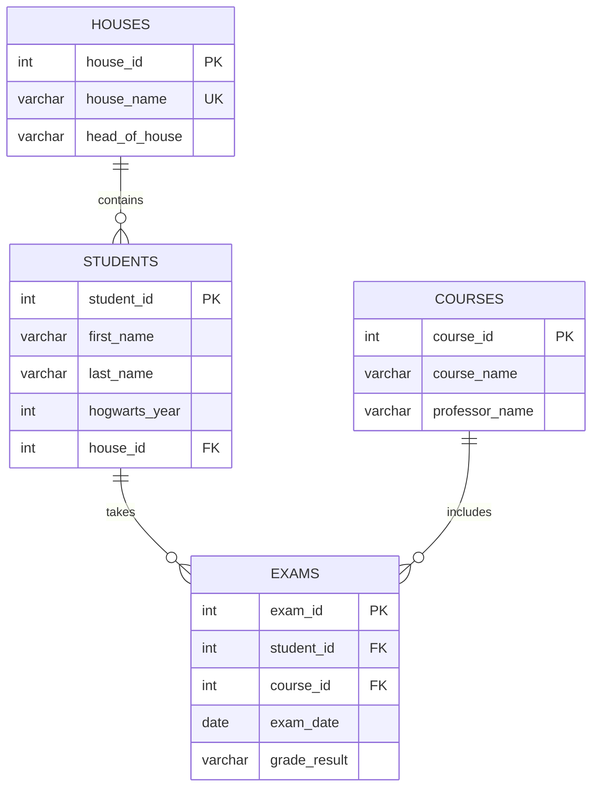

# Hogwarts SQL Sandbox: Architecture

## 1. Project Overview

Hogwarts SQL Sandbox is a PostgreSQL practice environment built around a fictional Hogwarts academic database.

It contains 30 SQL challenges, reference solutions, a Python-based test runner, and focused concept guides. The challenges progress from basic filtering and aggregation to window functions, recursive CTEs, JSONB, PostgreSQL arrays, upserts, materialized views, and query optimization.

**Primary technologies:**
- PostgreSQL 15
- Python
- psycopg2
- pytest
- Docker Compose

## 2. Repository Structure

```text
hogwarts-sql-sandbox/
│
├── docs/
│   ├── architecture.md
│   └── concepts/
│       ├── hierarchical_rollups_and_statistical_volatility.md
│       ├── moving_averages_window_framing.md
│       ├── nested_jsonb_architectural_guide.md
│       ├── postgresql_native_arrays_array_operations.md
│       ├── postgresql_upserts_mutation_mechanics.md
│       ├── query_explain_analyze.md
│       ├── recursive_ctes_state_tracking.md
│       └── time_series_gap_analysis.md
│
├── init/
│   ├── 01_schema.sql
│   └── 02_seed.sql
│
├── solutions/
│   └── 04_solutions.sql
│
├── workspace/
│   └── 03_challenges.sql
│
├── test_runner.py
├── docker-compose.yml
├── requirements.txt
├── .gitignore
└── README.md
```

### Directory responsibilities

| Component | Responsibility |
|---|---|
| `init/` | Defines the database schema and inserts sample data. |
| `workspace/` | Contains the 30 SQL challenge descriptions and serves as the place to write solutions. |
| `solutions/` | Stores reference SQL implementations. |
| `test_runner.py` | Extracts question blocks, executes queries, and compares results or performs dedicated checks. |
| `docs/concepts/` | Explains the PostgreSQL concepts used in the advanced challenges. |
| `docker-compose.yml` | Defines the PostgreSQL development environment. |
| `requirements.txt` | Lists the Python dependencies. |

## 3. Database Design

The database uses four relational tables:

- **houses:** Stores Hogwarts house names and their heads.
- **students:** Stores student details, Hogwarts year, and house membership.
- **courses:** Stores course names and professors.
- **exams:** Stores student exam attempts, course references, dates, and grades.

### Entity relationships



### Key constraints

- Primary keys uniquely identify records in each table.
- `students.house_id` references `houses.house_id`.
- `exams.student_id` and `exams.course_id` reference their respective parent tables.
- Deleting a student or course cascades to the associated exam records.
- The combination of `student_id`, `course_id`, and `exam_date` is unique, preventing duplicate exam records for the same student, course, and date.
- `grade_result` is restricted to the seven supported grades: `o++`, `o+`, `o`, `ee`, `a`, `p`, and `troll`.
- `hogwarts_year` must be between 1 and 7.

The schema is defined in `init/01_schema.sql`, while `init/02_seed.sql` populates the tables with the sample Hogwarts dataset.

## 4. Challenge Progression

The 30 challenges are organized by increasing SQL complexity.

| Range | Level | Main concepts |
|---|---|---|
| Q1–Q6 | Basic | Filtering, sorting, joins, and counting |
| Q7–Q13 | Intermediate | Aggregation, conditional logic, subqueries, and GPA calculations |
| Q14–Q20 | Advanced | Window functions, pivoting, JSONB, relational division, and conditional aggregation |
| Q21–Q28 | Expert | ROLLUP, statistical analysis, arrays, time-series analysis, upserts, and recursive CTEs |
| Q29–Q30 | PostgreSQL Mastery | Materialized views, telemetry metrics, and execution-plan analysis |

The progression is intended to build practical SQL skills, moving from retrieving relational data to solving more complex analytical and database-engineering problems.

## 5. Test Runner Architecture

`test_runner.py` uses Python, psycopg2, and pytest to execute and validate SQL solutions against the reference implementations.

Its main responsibilities are:

1. **Question extraction:** Identifies SQL blocks using the `-- QUESTION n:` marker convention.
2. **Marker integrity:** Checks that questions 1–30 are present exactly once in both SQL files.
3. **Query comparison:** Executes the workspace and reference queries in isolated savepoints, then compares their result columns and rows.
4. **Materialized-view validation (Q29):** Checks the actual contents of the generated `daily_exam_metrics` view against independently calculated daily metrics.
5. **Execution-plan validation (Q30):** Runs both `EXPLAIN ANALYZE` statements, checks their outputs, and compares the underlying query results and performance metrics.

The runner uses database transactions and savepoints to isolate query executions and roll back their changes.

**Important:** The workspace file initially contains challenge descriptions. A question is only testable once its SQL answer has been added beneath the corresponding marker.

## 6. PostgreSQL Concept Guides

The `docs/concepts/` directory contains focused explanations for the more advanced challenges.

| Guide | Related challenge | Main topic |
|---|---|---|
| `hierarchical_rollups_and_statistical_volatility.md` | Q21–Q22 | ROLLUP and standard deviation |
| `moving_averages_window_framing.md` | Q25 | Moving averages and window frames |
| `nested_jsonb_architectural_guide.md` | Q17 | Nested JSONB aggregation |
| `postgresql_native_arrays_array_operations.md` | Q23 | ARRAY_AGG and array containment |
| `postgresql_upserts_mutation_mechanics.md` | Q27 | ON CONFLICT, EXCLUDED, and RETURNING |
| `query_explain_analyze.md` | Q30 | Execution plans and query optimization |
| `recursive_ctes_state_tracking.md` | Q28 | Recursive CTEs and sequential state tracking |
| `time_series_gap_analysis.md` | Q24 | generate_series and missing-date analysis |

These guides provide additional context and explain why particular PostgreSQL techniques are useful beyond the individual exercises.

## 7. Local Development Workflow

### Prerequisites

- Docker and Docker Compose
- Python 3.10+
- Git

### Start PostgreSQL

```bash
docker compose up -d
```

The PostgreSQL container uses the `hogwarts` database and the `wizard` user. On the first initialization of its data directory, Docker automatically executes the SQL scripts mounted from `init/` in filename order.

### Install Python dependencies

```bash
pip install -r requirements.txt
```

### Work on challenges

1. Open `workspace/03_challenges.sql`.
2. Write your SQL answer below the relevant question marker.
3. Keep the reference implementations in `solutions/04_solutions.sql` separate from your workspace answers.
4. Run the test suite.

### Run tests

```bash
pytest -v
```

To run a specific question:

```bash
pytest -v -k query_25
```

To display additional output:

```bash
pytest -v -s
```

### Reset the database

The initialization scripts run automatically only when PostgreSQL initializes a fresh data directory.

To recreate the local sandbox from scratch:

```bash
docker compose down -v
docker compose up -d
```

**Warning:** Removing the volume deletes the existing database data. The schema and seed scripts will run again when the new database is initialized.

## 8. Design Principles

The project follows a few simple principles:

- **Practice before abstraction:** Each challenge focuses on a particular SQL problem or PostgreSQL feature.
- **Reference-based validation:** Query results are compared against reference implementations where appropriate.
- **Isolated execution:** Savepoints help prevent one test's changes from affecting another.
- **Concept-driven learning:** Advanced topics have dedicated guides rather than lengthy explanations inside the challenge file.
- **Practical database skills:** The exercises cover querying, data integrity, analytical SQL, and basic performance investigation.

---

**Project scope:** This is a local SQL learning and experimentation sandbox, not a production application. The sample credentials and database configuration are intended for local development only.